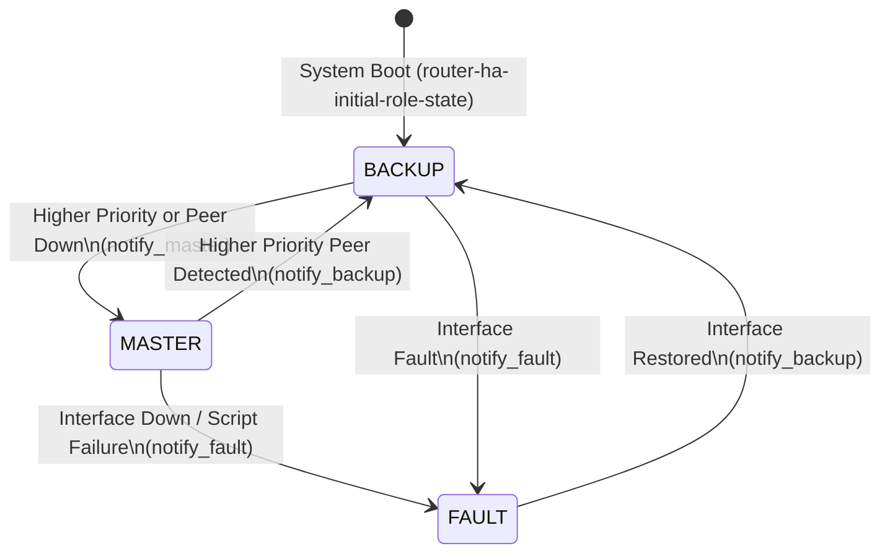

# Router Election Design

Status: **Design** (ported from unified `docs/design/router-election/` and updated for `nix-clan-homelab`)  
Related beads: `nch-sny.26` (router aspect), `nch-sny.27` (election design & rehearsal runbook), `nch-sny.21` (elitedesk install), `nch-sny.22` (router migration)

---

## 1. Overview and Direction

In the legacy configuration (`unified-nix-configuration`), routing was implemented as a monolithic host configuration on a single primary host (`router`), with active high availability disabled (`enableHa = false`) and an ad-hoc, dedicated standby VM that was eventually retired.

In `nix-clan-homelab`, the architecture evolves along three foundational principles:

1. **Routing as a composable Den aspect**: Routing is not an entire bespoke operating system image, but a composable aspect (`den.aspects.router-role`) applied to standard NixOS hosts alongside other roles and capabilities.
2. **Lifecycle and configuration managed by Clan**: Hardware reporting (`nixos-facter`), disk partitioning (`disko`), secret distribution (`clan vars` via sops), and fleet inventory are owned by Clan (`clan-core`), while deployment safety for router-class nodes is guaranteed by `deploy-rs` with magic rollback.
3. **Dynamic election with multiple candidates**: An election protocol (VRRP via Keepalived) dynamically selects which eligible host currently exercises router authority. The active winner owns the floating gateway IP (`10.10.10.1/16`), activates the WAN interface with the ISP-facing cloned MAC address, and starts single-active routing services (DHCP, DDNS, UPnP, IPv6 Router Advertisements).

---

## 2. Physical and Network Topology

### 2.1 WAN Physical Topology

The WAN path is strictly isolated from LAN traffic to prevent broadcast leaks, DHCP contention, and security boundary violations:

```
                      ┌──────────────────────┐
                      │      ISP Modem       │
                      │ (Single DHCP/PD lease│
                      │  locked to Gold MAC) │
                      └──────────┬───────────┘
                                 │ RJ45
                                 ▼
                      ┌──────────────────────┐
                      │   Unmanaged Switch   │
                      │ (Isolated WAN Layer 2│
                      │   Broadcast Domain)  │
                      └────┬────────────┬────┘
           RJ45 (Copper)   │            │ RJ45 (2.5 Gbps)
             2.5 Gbps      │            │
                           ▼            ▼
             ┌───────────────────┐    ┌─────────────────────┐
             │       router      │    │    Second Switch    │
             │   (enp6s17 / igc) │    │  (Media Converter)  │
             └───────────────────┘    └──────────┬──────────┘
                                                 │ 10G-SR Fibre
                                                 ▼
                                      ┌─────────────────────┐
                                      │      elitedesk      │
                                      │ (enp1s0f0 / X520-2) │
                                      └─────────────────────┘
```

Detailed physical connections:
- **Modem to Distribution**: The ISP modem connects via RJ45 directly into a dedicated unmanaged switch. This switch carries **WAN traffic only**; no LAN VLAN or subnet is connected to it.
- **Leg A (`router`)**: From the unmanaged switch, a copper RJ45 patch cable connects to `router`'s WAN NIC (`enp6s17`, Intel igc 2.5 Gbps controller).
- **Leg B (`elitedesk`)**: From the unmanaged switch, an RJ45 patch cable connects at 2.5 Gbps to a second switch acting as a media converter. From there, a 10G-SR multi-mode optical fibre run connects to `elitedesk`'s Intel X520-2 Dual-Port 10G SFP+ NIC port 0 (`enp1s0f0`).
- **Effective WAN Bandwidth**: Because the inter-switch link operates at 2.5 Gbps RJ45, `elitedesk`'s effective WAN throughput is 2.5 Gbit/s, matching `router`'s 2.5 Gbit/s capability and the repository setting `wanBandwidth = "2.5Gbit"`.
- **Infrastructure Consolidation**: The second switch (media converter) is a transitional convenience; one of the two switches will be retired when the final wiring is rationalized.
- **Standby WAN Administrative Invariant**: `elitedesk`'s WAN link is physically cabled, but **must remain administratively down** (the router role renders it `ActivationPolicy = always-down` with DHCP off for `mode = "standby"`, and a flake check fails the build if any standby host could bring its WAN up) while in standby.

### 2.2 The Single WAN Lease Constraint

The upstream ISP modem provides **exactly one** dynamic IPv4 address and one delegated IPv6 prefix (/64 or /56). The modem binds this lease to a specific hardware identifier:
- **Golden Cloned MAC Address**: `02:76:c6:01:2a:b0` (originally the physical/virtual MAC of `router`'s WAN interface).

**Critical Invariant**: At no time may both candidate routers bring up their WAN interfaces or issue DHCP requests simultaneously over the unmanaged switch. If both nodes transmit DHCP requests or claim the cloned MAC at the same time:
1. The modem will either drop packets due to MAC flap on the switch port, or
2. The ISP will bind the lease to one port while the other router blackholes return traffic, or
3. The lease will be revoked, resulting in total WAN outage for the homelab.

Therefore, WAN interface activation and cloned MAC assignment are strictly tied to VRRP election victory hooks (`notify_master`), while election demotion (`notify_backup` / `notify_fault`) immediately drives the WAN interface down.

### 2.3 LAN Topology

The LAN (`10.10.0.0/16`) hosts all internal clients, servers, and appliances:
- **Floating Gateway VIP**: `10.10.10.1/16` (RFC 5798 Virtual Router IP).
- **`router` LAN Interface**: `enp6s16` (Intel igc 2.5 Gbps, MAC `02:76:c6:01:2a:af`). In standalone mode it held `10.10.10.1/16`; in HA mode it holds a distinct node IP (e.g. `10.10.10.2/16`) while the VIP floats.
- **`elitedesk` LAN Interface**: `enp1s0f1` (Intel X520-2 port 1, MAC `90:e2:ba:7f:e0:3d`, node IP `10.10.10.4/16`). Note: requires `boot.extraModprobeConfig = "options ixgbe allow_unsupported_sfp=1"` to permit third-party SFP+ optical transceivers.

### 2.4 Out-of-band Management Plane

Both candidate nodes maintain dedicated, out-of-band management network interfaces on subnet `192.168.100.0/24`:
- **`router` Management NIC**: `ens18` (Intel e1000e, MAC `d0:50:99:8c:5f:9b`, IP `192.168.100.100/24`).
- **`elitedesk` Management NIC**: `eno1` (onboard Intel 82579LM Gigabit, MAC `24:be:05:06:9b:09`, IP `192.168.100.98/24`).

**Architectural Role**:
- The management plane is completely independent of LAN and WAN forwarding.
- Used for `deploy-rs` deployments, SSH administration, emergency serial/web consoles, and inter-router firewall state replication (`conntrackd`).
- Ensures that catastrophic failures on the data plane (e.g. broken nftables rules, VRRP flapping, or dead bridges) never lock operators out of the machines.

---

## 3. Candidate Hosts and Inventory-Driven Priority

### 3.1 Inventory Modeling (`homelab.hosts`)

Candidate router properties are declared in `inventory/hosts.nix` and typed via `modules/inventory.nix`. Under bead `nch-sny.26`, each router candidate is configured with:

```nix
# Example inventory declaration schema for router candidates
elitedesk = {
  kind = "nixos";
  system = "x86_64-linux";
  addresses.sshHostname = "192.168.100.98";
  roles = [ "router" "router-standby" ];
  router = {
    mode = "standby";            # "primary" or "standby"
    vrrpPriority = 110;          # Highest priority: preferred master
    vrrpId = 51;
    virtualIp = "10.10.10.1/16";
    lanDevice = "enp1s0f1";
    wanDevice = "enp1s0f0";
    managementDevice = "eno1";
    wanBandwidth = "2.5Gbit";
  };
};

router = {
  kind = "nixos";
  system = "x86_64-linux";
  addresses.ip = "10.10.10.1";
  addresses.sshHostname = "192.168.100.100";
  roles = [ "router" ];
  router = {
    mode = "primary";            # Active in unified; secondary priority in election
    vrrpPriority = 100;
    vrrpId = 51;
    virtualIp = "10.10.10.1/16";
    lanDevice = "enp6s16";
    wanDevice = "enp6s17";
    managementDevice = "ens18";
    wanBandwidth = "2.5Gbit";
  };
};
```

### 3.2 Candidate Priority Hierarchy

The election design supports multiple candidates through explicit numeric VRRP priorities:

| Candidate | Platform | Hardware Specs | VRRP Priority | Role in Homelab | Rationale for Priority |
|---|---|---|---|---|---|
| **`elitedesk`** | Bare-Metal | HP EliteDesk 8300 SFF, Core i7-3770, 16 GB DDR3, Intel 10G X520-2 Dual SFP+ | **110** (Highest) | **Preferred Primary Router** | Bare-metal execution eliminates Proxmox hypervisor restart dependencies, provides dedicated memory/bus bandwidth, and uses native 10G PCIe networking. |
| **`router`** | Proxmox VM | VM on `pve-rog`, passthrough Intel igc 2.5G NICs, 4 cores, 8 GB RAM | **100** (Secondary) | **Failover Standby Router** | Excellent backup router, but subject to host reboot cycles during Proxmox hypervisor updates. |
| **Future `spare-3`** | VM / Bare-Metal | Any candidate host satisfying router aspect requirements | **90** (Tertiary) | **Cold / Tertiary Standby** | Extensible N-candidate hierarchy. |

### 3.3 Preemption and Stability

Decision (user, 2026-11-18): a recovered elitedesk waits before taking the
router role back, so a flapping primary does not cause back-to-back
failovers.

- Every router starts as `BACKUP`; priority decides who becomes master
  (elitedesk 110, router 100). keepalived ignores `preempt_delay` on an
  instance that starts as `MASTER`; nix-router-optimized's
  `services.router-ha.preemptDelay` (upstream PR #144) handles both: with it
  set, every node starts as BACKUP.
- `preempt_delay` comes from the inventory: `router.vrrpPreemptDelay`,
  default 300 s (keepalived's maximum is 1000). When elitedesk returns it
  stays BACKUP for that long, then preempts if it is still healthy.
- Losing the master is not delayed: a BACKUP takes over within about three
  advertisement intervals (`advert_int 1`, protocol 112 to `224.0.0.18` on
  the LAN), so the delay only affects giving the role *back*.
- Fail-back is a full single-active handover (WAN, Kea, DDNS, RA move), so
  each one is a short outage; the delay trades a few extra minutes on the
  standby for fewer of them.

---

## 4. Election Mechanism and Keepalived Integration

### 4.1 The Sole Authority Principle

A central architectural lesson from the April 2026 incident (documented in `kea-vrrp-regression-postmortem.md`) is:

> **There must be exactly one authority that decides who is active.**

Running multiple uncoordinated state machines (such as Kea DHCP HA clustering alongside Keepalived VRRP) creates split-brain states where Keepalived considers Node A primary, but Kea considers Node B primary or stalls in `READY`/`WAITING`.

In our design:
- **VRRP (Keepalived) is the sole master authority** for the node's operational state (`MASTER`, `BACKUP`, or `FAULT`).
- All dependent application services (DHCP, DDNS, WAN interface, UPnP, IPv6 RA) are **slaved to VRRP state changes** via `notify_*` scripts and `/run/router-ha/role`.
- No application service runs its own multi-node clustering protocol across the LAN.

### 4.2 State Machine Transitions

Keepalived manages three runtime states:



1. **Boot Seeding**: Before Keepalived starts, `router-ha-initial-role-state.service` writes `backup` to `/run/router-ha/role`.
2. **Promotion to MASTER (`notify_master`)**:
   - Step 1: Update `/run/router-ha/role` to `master`.
   - Step 2 (Stateful Firewall): Commit replicated conntrack cache to kernel (`conntrackd -c`).
   - Step 3 (WAN Takeover): Set cloned MAC address `02:76:c6:01:2a:b0`, bring link up (`ip link set <wan> up`), and restart `systemd-networkd` to initiate DHCPv4 and DHCPv6-PD acquisition.
   - Step 4 (BGP / Routing): Activate BGP neighbors if BGP single-active owner is enabled.
   - Step 5 (Single-Active Units): Start all consumer single-active systemd units (`services.router-ha.singleActiveUnits`).
3. **Demotion to BACKUP / FAULT / STOP (`notify_backup` / `notify_fault` / `ExecStopPost`)**:
   - Step 1: Update `/run/router-ha/role` to `backup` or `fault`.
   - Step 2 (WAN Release): Bring WAN link administratively down (`ip link set <wan> down`).
   - Step 3 (Stateful Firewall): Flush conntrack internal cache (`conntrackd -f`).
   - Step 4 (Single-Active Units): Stop all consumer single-active systemd units.

---

## 5. Service Architecture and Incident Lessons

### 5.1 Service Classification Matrix

To ensure that candidate nodes can safely host non-routing workloads alongside the router aspect, homelab services are categorized into three distinct operational models:

| Service Category | Examples | Lifecycle Model | Management Mechanism |
|---|---|---|---|
| **Promotion-Aware (Single-Active)** | WAN interface, Kea DHCPv4, Kea DDNS, Inadyn DDNS updater, MiniUPnP, IPv6 RA Daemon | Started on promotion to `MASTER`; stopped immediately on `BACKUP` or `FAULT`. | `services.router-ha.singleActiveUnits` + Keepalived notification hooks. |
| **Shared Continuity** | Chrony NTP (`services.router-ntp`), SSH (`sshd`), Passive Suricata IDS | Active on **both nodes continuously**, regardless of VRRP state. | Standard systemd units enabled on all nodes. NTP listens on local and VIP addresses; Suricata inspects LAN traffic passively. |
| **Independent / Local** | Technitium DNS, Gatus monitoring, Netdata | Runs on both nodes; binds to localhost and local node IP (and VIP when present). | Local zones replicate by TSIG-signed zone transfer; see [Local DNS zone replication](#local-dns-zone-replication). |

### 5.2 Lessons Learned from Past Incidents

#### 1. Single-Active DHCP over Kea HA
- **Past Failure**: Kea HA in `READY` or `WAITING` state binds raw sockets, reads incoming DHCPDISCOVER broadcasts, but silently discards them without responding or logging `DHCP4_PACKET_RECEIVED`. This masqueraded as a low-level socket fault while starving clients of leases.
- **Adopted Design**: Kea runs in **single-active mode**. It is only running on the active VRRP master. The standby node keeps `kea-dhcp4-server.service` stopped. On failover, the promoted node starts Kea cleanly, reading the shared lease store or recovering leases via ARP/ping verification.

#### 2. Raw Socket Interface Formatting
- **Past Failure**: Kea 3.x fails to register `PF_PACKET` raw sockets when configured with address qualifiers (e.g. `enp6s16/10.10.10.2`).
- **Adopted Design**: The `router-kea` module strictly enforces bare interface names (e.g. `enp1s0f1`). Build-time assertions reject any interface specification containing `/`.

#### 3. Conntrackd and the Flowtable OFFLOAD Bug
- **Past Failure**: When `conntrackd -c` commits cached state into the kernel upon promotion, entries sourced from bulk dumps that had the `IPS_OFFLOAD` bit (0x4000) set failed injection with `-EBUSY` under `conntrack-tools 1.4.8`. Established flows (like active SSH or streaming connections) dropped during failover.
- **Adopted Design**:
  - `conntrack-tools` requires the OFFLOAD-masking fix (stripping `0x4000` and `0x8000` prior to netlink injection).
  - Conntrack sync traffic runs exclusively over the private **management plane** (`192.168.100.x` via UDP 3780) to avoid consuming LAN bandwidth.
  - Failover ordering strictly executes `conntrackd -c` *before* the WAN link is activated.

#### 4. Stork Server and Agent Placement
- **Past Failure**: `kea-ctrl-agent` and Kea's embedded HA HTTP listener both defaulted to TCP port 8000, causing port collisions.
- **Adopted Design**:
  - `stork-agent` bypasses `kea-ctrl-agent` entirely, connecting directly to Kea's local UNIX domain socket (`/run/kea/dhcp4.sock`).
  - `stork-server` (if deployed on the router) runs as a `singleActiveUnit` behind Caddy reverse proxy on port 8080.

#### 5. Deployment Generation Matching
- **Past Failure**: Deploying mismatched configuration generations across candidate nodes led to asymmetric protocol failures (e.g. one node on LAN-plane HA, the other on management-plane HA).
- **Adopted Design**: Prior to testing or executing failovers, both candidate nodes must be verified to run identical flake inputs and matching NixOS configuration generations.

---

## 6. Deployment Safety and Rollback

### 6.1 Tooling Split: deploy-rs for Routers

As established in decision [`0001-clan.md`](decisions/0001-clan.md) and proven in spike `nch-sny.5`:
- **Standard Hosts**: Use `clan machines update` (via `clan-admin`).
- **Routers (`elitedesk`, `router`)**: Must be deployed using **`deploy-rs` with magic rollback**.

### 6.2 The Magic Rollback Guarantee

When deploying network, firewall, or Keepalived changes:
1. `deploy-rs` copies the new closure to the target over the management plane (`192.168.100.x`).
2. It switches to the new profile and starts a countdown timer (e.g. 120 seconds).
3. It attempts to establish a fresh, independent SSH connection to the node.
4. If the new configuration breaks networking, blocks SSH, or panics the kernel, the confirmation connection fails.
5. `deploy-rs` automatically triggers rollback, reactivating the previous known-good generation and restoring network access without operator intervention.

**Operational Invariant**:
- Magic rollback requires that the target has had at least one successful `deploy-rs` activation.
- The initial deployment to a newly installed machine must be performed while console access (physical keyboard/monitor or Proxmox VNC) is at hand.

---

## 7. Migration Roadmap

The migration of router functionality to Clan proceeds through discrete stages:

1. **Bead `nch-sny.21` (Complete)**: `elitedesk` installed as first bare-metal Clan host with baseline networking and disks; WAN unmanaged and down.
2. **Bead `nch-sny.27` (This Work)**: Document election architecture (`docs/router-election.md`) and failover rehearsal runbook (`docs/router-failover.md`).
3. **Bead `nch-sny.26` (Next)**: Port `role.nix` into `den.aspects.router-role` with typed `homelab.hosts.<name>.router` submodule and build assertions.
4. **Bead `nch-sny.22` (Final)**: Live failover rehearsal; migration of `router` VM definition into Clan; promotion of `elitedesk` to primary router.

## Local DNS zone replication

Kea DDNS writes `deepwatercreature.com` and `10.10.in-addr.arpa` into the
primary's Technitium runtime state; no configuration declares those records.
A standby therefore keeps copies by zone transfer
(`services.router-technitium.zoneReplication` in nix-router-optimized):

- **Primary.** Allows AXFR/IXFR of both zones only from the standby LAN
  addresses (derived from inventory standby hosts), only when signed with the
  TSIG key `zone-transfer`. It sends NOTIFY to those standbys on every change.
- **Standby.** Holds both zones as Secondary zones of `10.10.10.1`. The
  `router-standby` check fails if a standby lacks them.
- **Key.** The shared clan var `router-technitium-zone-transfer-tsig`.
  unified's `router` reads the same value from
  `secrets-agenix/technitium-zone-transfer-tsig.age` until it migrates.

Open for VRRP (`nch-sny.30`): a secondary is read-only, so the new MASTER must
promote both zones to Primary (Technitium `zones/convert`) before Kea DDNS can
write to it, and demote them again on BACKUP. The sync unit never demotes a
promoted zone on its own, so activation during a failover is safe.

